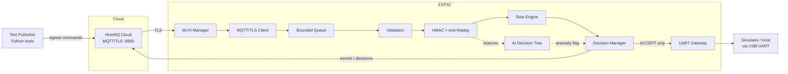
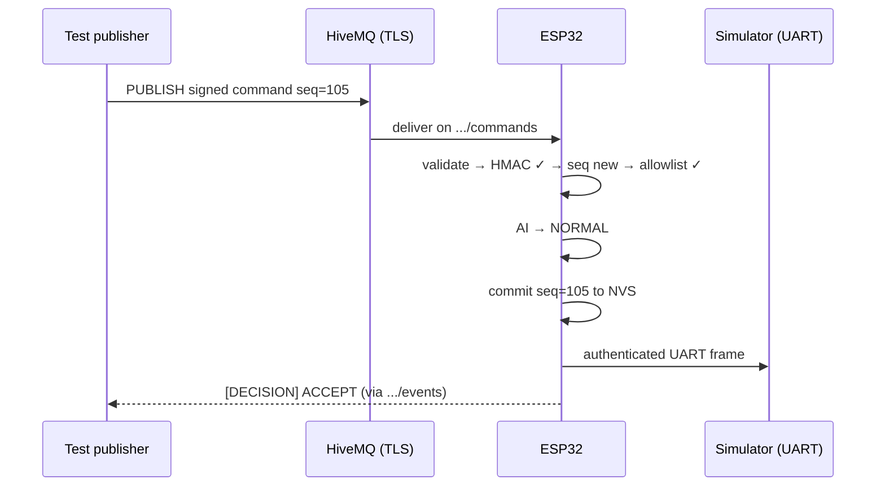
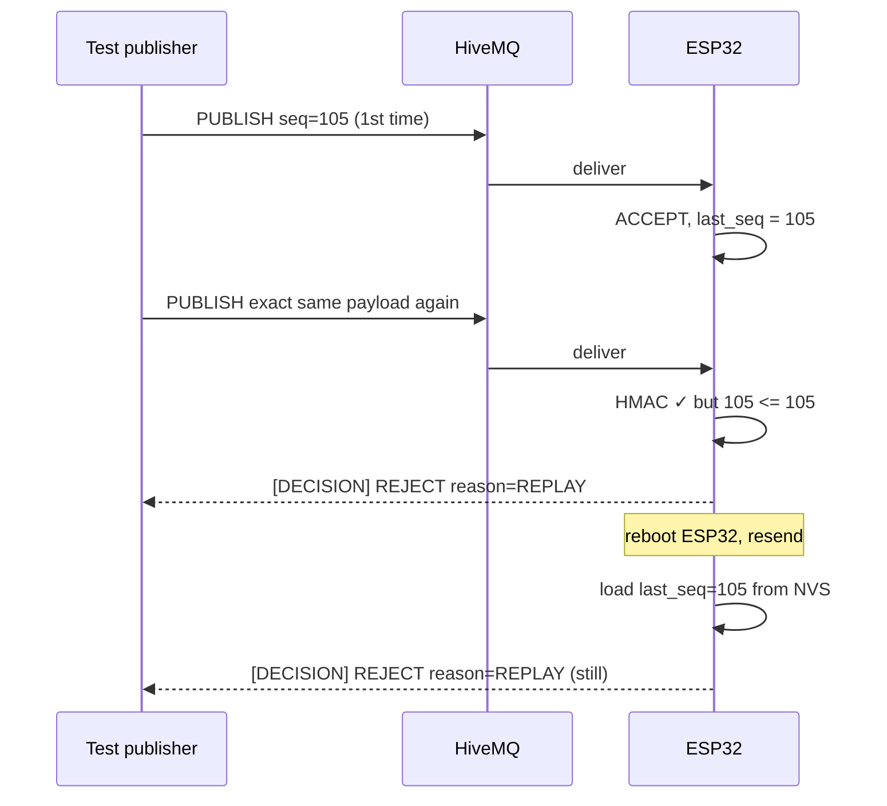

# DroneShield AI

**ESP32-S2 embedded security gateway** — ESP-IDF 5.5.x, C, HiveMQ Cloud over TLS.

Receives MQTT commands, validates them, runs **deterministic security rules** plus a
**small local decision tree**, and forwards **only accepted** messages to the
UART/simulator link. It never blindly forwards incoming data.

```
Receive → Validate → Authenticate → Rule check → AI anomaly → Decide → Forward
```

---

## Table of contents

1. [Overview](#1-overview)
2. [Architecture diagrams](#2-architecture-diagrams)
3. [Message pipeline](#3-message-pipeline)
4. [Project structure](#4-project-structure)
5. [Module guide (read in this order)](#5-module-guide-read-in-this-order)
6. [Command format & signing](#6-command-format--signing)
7. [Decision logic](#7-decision-logic)
8. [UART frame format](#8-uart-frame-format)
9. [AI model](#9-ai-model)
10. [Attack scenarios S1 / S2 / H1 / H2](#10-attack-scenarios)
11. [Build, flash, secrets](#11-build-flash-secrets)
12. [Expected logs](#12-expected-logs)
13. [Security notes & limits](#13-security-notes--limits)

---

## 1. Overview

DroneShield AI sits between **HiveMQ Cloud** and a **drone simulator** (or host).
Every message goes through the same pipeline. The AI is *supplementary* — it can
only make the system more suspicious, never less.

| Layer | Role | Can reject? | Can accept alone? |
|-------|------|-------------|-------------------|
| Validation | size, JSON, types, device ID, timestamp | yes | no |
| HMAC + TLS | authenticity of command + transport | yes | no |
| Anti-replay | sequence freshness (persistent) | yes | no |
| Rule engine | allowlist, params, topic | yes | no |
| Decision tree | behavioral anomaly | no (flags) | no |
| Decision manager | combines everything | **final say** | **yes** |

**Threat scenarios covered**

| ID | Category | Attack | Protection |
|----|----------|--------|------------|
| S1 | Software | MQTT replay | Persistent sequence numbers (NVS), freshness checks |
| S2 | Software | Unauthorized publish / spoof / tamper | TLS, credentials, topic permissions, HMAC-SHA256 |
| H1 | Hardware | UART access & command injection | Authenticated UART frames, strict parser |
| H2 | Hardware | Firmware extraction / modification | Secure Boot V2 + Flash Encryption (spare board) |

---

## 2. Architecture diagrams

### 2.1 System context



### 2.2 Layered view

```
┌─────────────────────────────────────────────────────────────────┐
│  HiveMQ Cloud (MQTT over TLS, port 8883, cert verified)         │
└────────────────────────────┬────────────────────────────────────┘
                             │ Wi-Fi (WPA2/WPA3)
┌────────────────────────────▼────────────────────────────────────┐
│  ESP32-S2                                                       │
│                                                                 │
│  ┌──────────────┐   ┌─────────────────────────────────────┐     │
│  │ Wi-Fi Manager│──►│ MQTT/TLS Client                     │     │
│  │ backoff, SNTP│   │ short callback: copy ≤512 B → queue │     │
│  └──────────────┘   └──────────────┬──────────────────────┘     │
│                                    │ FreeRTOS queue (depth 8)   │
│  ┌─────────────────────────────────▼───────────────────────┐    │
│  │ Processing task (never in the MQTT callback)            │    │
│  │                                                         │    │
│  │  1. message_validator   size/JSON/types/device/seq/ts   │    │
│  │  2. crypto_security     HMAC-SHA256, constant-time cmp  │    │
│  │  3. anti_replay         seq > last_accepted (NVS)       │    │
│  │  4. rule_engine         allowlist + param ranges        │    │
│  │  5. feature_extractor   rolling 5 s window              │    │
│  │  6. ai_model            decision tree → NORMAL/ANOMALY  │    │
│  │  7. decision_manager    ACCEPT/REJECT/LIMIT/QUARANTINE  │    │
│  └───────────┬─────────────────────────────┬───────────────┘    │
│              │ ACCEPT                      │ REJECT + reason    │
│  ┌───────────▼───────────┐   ┌─────────────▼──────────────┐     │
│  │ UART Gateway (UART1)  │   │ security_logger            │     │
│  │ HMAC-tagged frames    │   │ event IDs, no secrets      │     │
│  └───────────┬───────────┘   └─────────────┬──────────────┘     │
└──────────────┼─────────────────────────────┼────────────────────┘
               ▼                             ▼
        Simulator / Host              MQTT .../events topic
```

### 2.3 Responsibility split: rules vs AI

```
            ┌────────────────────────────────────────┐
            │           Incoming message             │
            └───────────────────┬────────────────────┘
                                ▼
                    ┌───────────────────────┐
                    │  RULES (authoritative)│
                    │  invalid HMAC    ─────┼──► REJECT
                    │  replayed seq    ─────┼──► REJECT
                    │  unknown command ─────┼──► REJECT
                    │  wrong device    ─────┼──► REJECT
                    │  oversized       ─────┼──► REJECT
                    │  bad UART tag    ─────┼──► REJECT
                    └───────────┬───────────┘
                                │ all rules passed
                                ▼
                    ┌───────────────────────┐
                    │  AI (decision tree)   │
                    │  unusual rate, bursts,│
                    │  reconnect storms, …  │
                    └───────────┬───────────┘
                          ┌─────┴─────┐
                          ▼           ▼
                       NORMAL     ANOMALY
                          │           │
                          ▼           ▼
                       ACCEPT    QUARANTINE
                          │      (or RATE_LIMIT)
                          ▼
                   forward to UART
```

> The AI **cannot** turn a REJECT into an ACCEPT. Ever.

---

## 3. Message pipeline

Exact validation order (from the spec):

```
 1. Reject payload > 512 bytes          ── before any parsing
 2. Parse JSON safely (cJSON, bounded)
 3. Required fields + exact data types
 4. Check device_id == "device_01"
 5. Validate seq as non-negative integer (reject fractions / range)
 6. Check timestamp freshness (±300 s, only if SNTP time is valid)
 7. Require exactly 64 hex signature characters
 8. Decode + verify HMAC-SHA256 (constant-time compare)
 9. Reject seq not newer than last accepted     (anti-replay check)
10. Command allowlist + parameter ranges
11. Rate limits + hybrid AI detection
12. Persist sequence (NVS) — fail closed on error   [only on ACCEPT]
13. Forward accepted command to UART/simulator
```

### Sequence diagram — valid command



### Sequence diagram — replay (S1)



---

## 4. Project structure

```
droneshield_ai/
├── CMakeLists.txt              # ESP-IDF project file
├── sdkconfig.defaults          # TLS, certificate bundle, logging
├── .gitignore                  # build/, sdkconfig, secrets.h
├── README.md                   # this file
│
├── ../drone_ai_model/                   # OFFLINE training (PC only, not on device)
│   ├── README.md               # real-capture + train → export workflow
│   ├── collect_serial.py       # REAL data: ESP32 serial/log → dataset.csv
│   ├── collect_mqtt.py         # REAL data: live HiveMQ → dataset.csv
│   ├── adapt_mqtt_uad.py       # REAL data: MQTT_UAD (figshare) → dataset.csv
│   ├── dataset.csv             # your captures (created by collectors)
│   ├── train_model.py          # trains tree → writes ../main/exported_model.*
│   └── make_dataset.py         # synthetic smoke-test only (not for reports)
│
└── main/                       # ALL firmware code lives here
    ├── CMakeLists.txt          # sources + component REQUIRES
    │
    ├── main.c                  # entry point: init + wiring
    ├── app_config.h            # every constant, topic, limit, frame layout
    ├── secrets.h               # local secrets (gitignored)
    ├── secrets.h.example       # committed template
    │
    ├── wifi_manager.c/.h       # Wi-Fi events, backoff, SNTP
    ├── mqtt_manager.c/.h       # TLS MQTT + bounded RX queue
    ├── message_validator.c/.h  # structure / types / freshness
    ├── crypto_security.c/.h    # HMAC-SHA256 + constant-time compare
    ├── anti_replay.c/.h        # persistent sequence in NVS
    ├── rule_engine.c/.h        # authoritative checks
    ├── feature_extractor.c/.h  # rolling 5-second features
    ├── exported_model.c/.h     # trained tree (GENERATED by ../drone_ai_model/)
    ├── ai_model.c/.h           # tree inference
    ├── decision_manager.c/.h   # rate limit → rules → AI → decide
    ├── uart_gateway.c/.h       # authenticated UART frames
    └── security_logger.c/.h    # event IDs + reason codes, no secrets
```

---

## 5. Module guide (read in this order)

| # | File | What it teaches you |
|---|------|---------------------|
| 1 | `main/app_config.h` | Topics, payload limits, UART layout, allowlist, how secrets load |
| 2 | `main/secrets.h.example` | Which credentials/keys you must fill in |
| 3 | `main/main.c` | Startup order: NVS → features → UART → MQTT → Wi-Fi → processing task |
| 4 | `main/wifi_manager.c` | Disconnect logging, bounded exponential backoff (1→32 s), SNTP, counters |
| 5 | `main/mqtt_manager.c` | TLS + cert verification; **short callback** that only enqueues data; flush on reconnect |
| 6 | `main/message_validator.c` | Validation order 1–7, canonical params (sorted-key JSON) |
| 7 | `main/crypto_security.c` | Canonical string, HMAC-SHA256, constant-time comparison |
| 8 | `main/anti_replay.c` | NVS `last_seq`, fail-closed behavior |
| 9 | `main/rule_engine.c` | Full rule order: topic → validate → HMAC → replay → allowlist |
| 10 | `main/feature_extractor.c` | 11 features over a rolling 5 s window |
| 11 | `main/exported_model.h/.c` | Tree node layout and the trained tree data |
| 12 | `main/ai_model.c` | Walks the tree, returns NORMAL/ANOMALY, times inference |
| 13 | `main/decision_manager.c` | Rate limit, combines rules+AI, commits sequence, forwards |
| 14 | `main/uart_gateway.c` | Frame parser, HMAC tag, rejects malformed/unauth/replay |
| 15 | `main/security_logger.c` | Reason codes only — never keys or full payloads |

---

## 6. Command format & signing

### Payload

```json
{
  "device_id": "device_01",
  "seq": 105,
  "timestamp": 1790000000,
  "command": "STATUS_REQUEST",
  "params": {},
  "signature": "64_lowercase_hex_characters_here____________________"
}
```

### Canonical string (this is what gets signed — never raw JSON)

```
device_id | seq | timestamp | command | canonical_params
```

Examples:

```
device_01|105|1790000000|STATUS_REQUEST|{}
device_01|106|1790000001|ARM|{"mode":1}
```

```
signature = HMAC_SHA256(shared_secret, canonical_message)
```

`canonical_params` = JSON with **sorted keys** and **no whitespace**, so
`{"b":1,"a":2}` → `{"a":2,"b":1}`. The ESP32 rebuilds the exact same string,
decodes the 64 hex chars to 32 bytes, and compares in **constant time**.

### Allowlisted commands

| Command | Params |
|---------|--------|
| `STATUS_REQUEST` | `{}` |
| `PING` | `{}` |
| `ARM` | optional `{"mode":0}` or `{"mode":1}` |
| `DISARM` | `{}` |
| `SIM_RESET` | `{}` |

Anything else → `REJECT reason=UNKNOWN_COMMAND`.

### Topics

| Topic | ESP32 does |
|-------|------------|
| `droneshield/device_01/commands` | **subscribes** (only this one — never `#`) |
| `droneshield/device_01/status` | publishes |
| `droneshield/device_01/events`  | publishes decisions (reason codes, no secrets) |

---

## 7. Decision logic

```c
if (!rate_limit_allow)            → RATE_LIMIT
else if (rules failed)            → REJECT   // reason from rule engine
else if (ai == ANOMALY)           → QUARANTINE  // sequence NOT committed
else if (!nvs_commit(seq))        → REJECT   // fail closed
else                              → ACCEPT   // commit seq → UART forward
```

Rate limit: token bucket, **burst 10**, refill **1 per second**.

Why commit the sequence only on ACCEPT?
The spec says *"reject sequence numbers not newer than the last **accepted**
number"* — quarantined messages must not permanently burn a sequence number.

---

## 8. UART frame format

Dedicated **UART1** (TX=17, RX=18). UART0 stays the debug console, so the
application protocol is never mixed with the log console.

```
 byte:  0    1    2    3    4  5  6  7    8  9    10 .. 10+N-1   10+N .. 10+N+15
      ┌────┬────┬────┬────┬──────────┬──────────┬───────────────┬────────────────┐
      │ AA │ 55 │ver │type│ seq u32  │ len u16  │ payload[N]    │ tag (16 bytes) │
      └────┴────┴────┴────┴──────────┴──────────┴───────────────┴────────────────┘
```

- `ver` = 1, `type` = 0x01 command / 0x02 ack / 0x03 event
- `len` = N (max 256)
- `tag = HMAC_SHA256(DSHL_UART_KEY, all bytes before tag)[0..15]`
- Parser rejects: bad magic, wrong version, oversize, length mismatch,
  bad tag, replayed `seq`

---

## 9. AI model

Training lives in **`../drone_ai_model/`** (PC, Python). Only the exported C tree runs
on the ESP32. The dataset must be **real** — captured from your device during
normal and attack sessions (no synthetic CSV is committed).

```
 ┌──────────────────────────┐   ┌──────────────────────────┐
 │ collect_serial.py        │   │ collect_mqtt.py          │
 │ ESP32 logs (all features)│   │ HiveMQ traffic (partial) │
 └────────────┬─────────────┘   └────────────┬─────────────┘
              └──────────┬───────────────────┘
                         ▼
              ┌─────────────────────────┐
              │ ../drone_ai_model/dataset.csv    │  session_id + label + 11 features
              └────────────┬────────────┘
                           ▼
              ┌─────────────────────────┐
              │ python train_model.py   │  split BY SESSION
              │ precision/recall/F1/FPR │
              └────────────┬────────────┘
                           ▼
              ┌─────────────────────────┐
              │ main/exported_model.*   │  ← firmware code
              └────────────┬────────────┘
                           ▼
                     idf.py build
```

```bash
cd ai_model
# 1. record REAL sessions (unique --session per capture)
python collect_serial.py --port COM5 --session s01_normal --label 0 --duration 120
python collect_serial.py --port COM5 --session s10_replay --label 1 --duration 120

# 2. train + export into ../main/
python train_model.py

# 3. firmware uses the new tree
cd .. && idf.py build
```

Full capture guide: [`../drone_ai_model/README.md`](../drone_ai_model/README.md)

- **Type:** shallow `DecisionTreeClassifier` (max depth 4), exported as a C node array (`main/exported_model.c`)
- **Features (11), rolling 5-second windows:**

  | Feature | Meaning |
  |---------|---------|
  | `mqtt_msg_count` | MQTT messages received |
  | `avg_payload_len` | average payload size |
  | `max_payload_len` | maximum payload size |
  | `duplicate_count` | duplicate sequences |
  | `invalid_json_count` | malformed JSON |
  | `unknown_topic_count` | unexpected topics |
  | `invalid_command_count` | commands outside allowlist |
  | `wifi_disconnect_count` | Wi-Fi disconnects |
  | `mqtt_reconnect_count` | MQTT reconnects |
  | `uart_frame_error_count` | malformed UART frames |
  | `uart_bytes_per_second` | UART traffic rate |

- **Node format:**
  ```c
  typedef struct {
      int8_t   feature;    // >= 0: test this feature; < 0: leaf
      float    threshold;  // value <= threshold → left, else right
      int32_t  left;
      int32_t  right;      // leaf: left encodes label 0=normal, 1=anomaly
  } dshl_ai_node_t;
  ```
- **Authority:** only ACCEPT → QUARANTINE. Never overrides a rule rejection.
- No secrets or passwords are ever fed to the model.

> Collect real sessions with `collect_serial.py` before trusting metrics.
> `make_dataset.py` exists only to smoke-test the training pipeline.

---

## 10. Attack scenarios

### S1 — MQTT replay
1. Publish a valid signed command with `seq=105` → **ACCEPT**, NVS stores 105
2. Publish the exact same payload again → **REJECT** `reason=REPLAY`
3. Reboot the ESP32, resend → **still REJECT** (sequence loaded from NVS)
4. No remote command can reset the sequence

### S2 — Unauthorized publish / spoof / tamper
| Test | Expected |
|------|----------|
| Unauthorized MQTT identity | Broker denies (if topic permissions configured) |
| Missing signature | REJECT `MISSING_FIELD` / `SIG_FORMAT` |
| Wrong-key signature | REJECT `HMAC_INVALID` |
| Tampered command/params | REJECT `HMAC_INVALID` |
| Wrong `device_id` | REJECT `DEVICE_ID` |
| Oversized payload | Dropped before JSON (`OVERSIZE`) |
| Any rejected message | **Never** forwarded to UART |

### H1 — UART injection
| Test | Expected |
|------|----------|
| Garbage bytes | `UART_FRAME_ERROR` |
| Oversized length | `UART_OVERSIZE` |
| Valid frame, bad tag | `UART_BAD_TAG` |
| Frame replay | `UART_REPLAY` |
| Fresh authenticated frame | accepted |

### H2 — Firmware protection
**Only on a disposable spare board** — Secure Boot V2 and Flash Encryption burn
eFuses and can permanently change the device. Document baseline readout first,
then verify unsigned images are rejected. See the ESP-IDF 5.5 ESP32-S2 docs.

---

## 11. Build, flash, secrets

### Secrets (never commit)

Edit `main/secrets.h` (gitignored; template = `secrets.h.example`):

```c
#define DSHL_WIFI_SSID      "..."
#define DSHL_WIFI_PASSWORD  "..."
#define DSHL_MQTT_HOST      "xxxx.s1.eu.hivemq.cloud"
#define DSHL_MQTT_PORT      8883
#define DSHL_MQTT_USERNAME  "droneshield_device_01"
#define DSHL_MQTT_PASSWORD  "..."
#define DSHL_MQTT_CLIENT_ID "droneshield_device_01"
#define DSHL_HMAC_KEY       "long-random-string"
#define DSHL_UART_KEY       "different-long-random-string"
```

### Build & flash (ESP-IDF 5.5.x)

```powershell
# set up the environment (idf_cmd_init.bat, or:)
$env:IDF_PATH='C:\Espressif\frameworks\esp-idf-v5.5.5'
$env:IDF_PYTHON_ENV_PATH='C:\Espressif\python_env\idf5.5_py3.11_env'

idf.py set-target esp32s2     # already done for this project
idf.py build
idf.py -p COMx flash monitor
```

Wi-Fi must be **WPA2/WPA3 with a strong passphrase** — never an open network.
TLS is always used, even on a trusted LAN.

---

## 12. Expected logs

**Valid command:**
```
[MQTT]       Message received
[CRYPTO]     HMAC valid
[DECISION]   ACCEPT stage=final reason=OK seq=105 cmd=STATUS_REQUEST
[UART_GW]    UART authenticated frame type=1 seq=105 ...
```

**Replay (S1):**
```
[MQTT]       Message received
[CRYPTO]     HMAC valid
[RULES]      Replay detected: seq=105 last=105
[DECISION]   REJECT stage=rules reason=REPLAY seq=105 cmd=STATUS_REQUEST
```

**Spoofed / tampered (S2):**
```
[DECISION]   REJECT stage=rules reason=HMAC_INVALID seq=200 cmd=STATUS_REQUEST
```

**Wi-Fi recovery:**
```
[EVENT] id=101 ... WIFI_DISCONNECTED
[EVENT] id=102 ... WIFI_RECONNECT_ATTEMPT   (backoff, repeated)
[EVENT] id=103 ... WIFI_RECONNECTED
```

---

## 13. Security notes & limits

| Control | Does | Does **not** |
|---------|------|--------------|
| TLS | Encrypts transport, authenticates broker | Authenticate individual commands |
| MQTT user/pass | Authenticates client to HiveMQ | Restrict topics (unless permissions configured) |
| HMAC-SHA256 | Authenticates command content | Replace TLS |
| Sequence number | Block replay of accepted commands | Prove sender identity |
| Decision tree | Flag unusual traffic | Override any rule |
| Reconnect logs | Show resilience | Prevent jamming / deauthentication |

**v1 is not:** flight control, navigation, dashboard, cloud AI, large neural
networks, wireless IDS, or OTA. A secret compiled into ordinary firmware can be
extracted without H2 protections — production provisioning needs stronger key
storage.

**Wi-Fi limitation:** detecting disconnect + reconnecting demonstrates
*resilience*, not prevention of deauth/jamming attacks.

---

*Start reading at [Section 5](#5-module-guide-read-in-this-order) with
`main/app_config.h` — everything else builds on it.*
